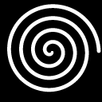

# Клеймо на донышке

Клеймо — вдавленная надпись по кругу у края дна и лого в центре. Читается на
перевёрнутом изделии; кнопка **«Показать дно»** разворачивает камеру на
донышко.

Клеймо идёт всюду, где есть изделие: в печатное изделие, в мастер-позитив,
в полость литейной формы и в пол отминочной формы (там оно выпуклое, чтобы
на изделии вышло вдавленным). Литейная форма с клеймом всегда получает
отдельную донную плиту: половинки клеймо не сняли бы.

## Строка

| Параметр | Диапазон | По умолч. | Что делает |
|---|---|---|---|
| Строка | до 60 символов | — | текст по кругу у края дна, верх букв к краю |
| Шрифт | Rubik, PT Serif, Comfortaa, Oswald | Rubik | все четыре — с кириллицей |
| Дата | галочка | нет | дописывает в конец строки дату (`ДД.ММ.ГГГГ`); число запоминается в момент, когда ставите галочку — снять и поставить, чтобы обновить |
| Начало строки | 0–355° | 0 | угол начала по часовой от «двенадцати», если смотреть на дно |
| Кегль | 2–15 мм | 5 | высота прописной буквы; мельче 4 мм в глине читается плохо |
| Отступ от края | 0–30 мм | 1.5 | от края плоского дна до верха букв |
| Глубина | 0.1–1.5 мм | 0.5 | насколько клеймо вдавлено в дно; у полого изделия — не глубже, чем позволяет толщина дна |

Если строка длиннее окружности, кегль автоматически ужимается (приложение
скажет, до скольких процентов). Если места на дне нет вовсе — уменьшите
кегль или отступ.

## Лого

| Параметр | Диапазон | По умолч. | Что делает |
|---|---|---|---|
| Лого | файл | — | картинка в центре дна, до 128 px по длинной стороне; белое вдавливается на всю глубину, чёрное остаётся |
| Инвертировать | галочка | нет | меняет местами рисунок и фон |
| Поворот лого | 0–355° | 0 | по часовой, если смотреть на дно |
| Размер лого | 5–120 мм | 25 | длинная сторона картинки на дне |
| Убрать лого | кнопка | | удаляет картинку |

Лого хранится в состоянии и переезжает со ссылкой и файлом пресета.

### Пример

[examples/logo-spiral.png](examples/logo-spiral.png) — простая спираль,
128×128 px: белая линия на чёрном фоне, поэтому она вдавится в дно, а фон
останется. Загрузите её кнопкой «Лого» и нажмите «Показать дно». Чтобы
спираль осталась выпуклой, а вдавился фон вокруг неё, поставьте
«Инвертировать» — вдавится тогда весь квадрат картинки, со спиралью внутри. Линия в файле — около 5 px, так что при размере 25 мм она
выходит меньше миллиметра шириной; для глины разумнее 40–60 мм.

Клеймо бывает только вдавленным и только на дне — на крышке его нет.
